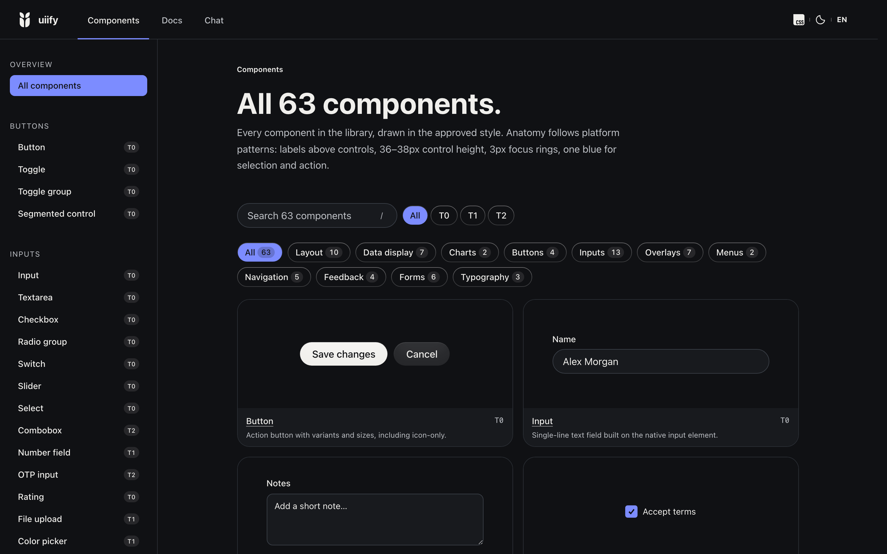

<p align="center">
  
</p>

<h1 align="center">uiify</h1>

<p align="center"><strong>Turn a brief into three designs from your design system.</strong><br>React components and a skill for your coding agent.</p>

<p align="center">
  <a href="https://uiify.gunkin.dev/components"><strong>Components</strong></a> ·
  <a href="https://uiify.gunkin.dev/docs">Docs</a> ·
  <a href="#try-it-with-your-coding-agent">Get started</a> ·
  <a href="#ai-coding-agents">AI agents</a>
</p>

<p align="center">
  <a href="https://www.npmjs.com/package/@gunkin/uiify"></a>
  <a href="https://react.dev"></a>
  <a href="https://uiify.gunkin.dev/components"></a>
  <a href="LICENSE"></a>
</p>

UIify gives your coding agent your components and their rules, so you write a short brief, compare
three designs in a preview and ship one by changing one line.

> Early alpha: APIs may change between versions. Tested with Claude Code on Next.js and Vite.

## Try it with your coding agent

Paste this into your coding agent in a React 19.3 project with Tailwind CSS 4.1 or later. Replace
"our sign-up page" with the screen you want to try:

```text
Set up uiify in this project: install @gunkin/uiify, then run npx @gunkin/uiify init (details: https://uiify.gunkin.dev/docs/ai-agents). Then, as the PM, write a brief and three designs for our sign-up page and show me the preview.
```

1. **Write a brief.** A few lines: the problem, who sees the screen, the one number that should move
   and the real copy.
2. **Get three designs.** The agent builds three layouts from your design system's components, fills
   them with your copy and shows them side by side in a preview.
3. **Pick one by changing one line.** One file imports the chosen design. Change that import to ship
   another; the page and its data stay as they are.

It works next to shadcn/ui and your own components: UIify adds two lines to your stylesheet after
shadcn's and uses your shadcn colors and radii. How the agent is connected, and the checks that keep
its screens on your system, are in [AI coding agents](#ai-coding-agents).

Tried it? Tell us where you got stuck:
[open an issue](https://github.com/antongunkin/uiify/issues/new?template=tried-it.yml).

## Components

The components are built on modern HTML, CSS, and DOM APIs. They work before hydration and with
JavaScript disabled; client JavaScript is added only where the accessibility tree needs it. They are
tree-shakeable and work in Server Components.

<p align="center">
  <a href="https://uiify.gunkin.dev/components"></a>
</p>

## Install

```bash
npm install @gunkin/uiify react react-dom
```

## Use

```tsx
import { Button } from "@gunkin/uiify/components/button";
import "@gunkin/uiify/components/behavior.css";

export function SaveButton() {
  return <Button>Save</Button>;
}
```

`behavior.css` contains required state behavior but no visual theme. Optional styles:

```css
@import "@gunkin/uiify/styles/reset";
@import "@gunkin/uiify/styles/tokens";
@import "@gunkin/uiify/styles";
```

Use focused `@gunkin/uiify/components/*`, `@gunkin/uiify/elements/*`, `@gunkin/uiify/core/*`, or `@gunkin/uiify/hooks` imports in
Server Components so client boundaries remain explicit.

## AI coding agents

The package ships a closed component catalog for coding agents, the `/uiify` skill and a screen
check, all matching the installed version. From the app's folder, copy the skill into your project
(Claude Code reads `.claude/skills`, the scripts and other agents `.agents/skills`) and write the
catalog into your `AGENTS.md`:

```bash
npx @gunkin/uiify init
```

`init` adds a section between `uiify:start` and `uiify:end` with a few fixed rules and
every component, part and closed prop value under its shadcn name (`Dialog`, `PopoverContent`,
`InputOTP`, `NativeSelect`, `CardHeader`, `RadioGroupItem`, `TabsTrigger`). It also updates
`CLAUDE.md` when that file exists and does not import `AGENTS.md` (`@AGENTS.md`), and writes
`.claude/rules/uiify.md`, a short file with the screen rules and the skill path,
for agents that do not expand `@AGENTS.md` imports, such as Onlook's. Commit the skill folders and run
`init` again after each upgrade; `--check` fails CI when the section is missing, outdated or edited.

A screen arranges UIify parts and never sets a raw color; `className` and `style` customize a part
(`className` with theme classes on Tailwind's default scale: no palette colors; arbitrary values like
`p-[13px]` only when no step fits, the check warns). A feature with
several designs keeps its slots in `contract.ts`, and the check makes every design take exactly those
slots and makes `active.ts` import exactly one design, so the build gets only that one. Check what the agent wrote, together with `tsc` (with TypeScript 7, also install
`@typescript/typescript6`: the check needs its parser API):

```bash
node .agents/skills/uiify/scripts/check-screens.mjs src/screens
```

Without links (Windows, or a skill kept in git), copy the directory to both places and rerun the
copy on upgrade. Without the skill, point the agent at the version-matched rules and references
with one line in `AGENTS.md` (or `CLAUDE.md`):

```text
For @gunkin/uiify, read node_modules/@gunkin/uiify/agents/index.md
```

In a monorepo with hoisted dependencies, point to the nearest `node_modules/@gunkin/uiify`.
Full guide: https://uiify.gunkin.dev/docs/ai-agents

### `/uiify` page-building skill

The package also includes the `/uiify` AI skill. Invoke it explicitly when creating or improving a
web page with UIify. It adds component and UX knowledge to your request while preserving the agent's
normal workflow: no staged approvals, routine questions or special status output. It follows the
requested framework route and existing workspace conventions, reads version-matched component
references and supports custom UI for components UIify does not provide. Existing design decisions
are reused; invoking the skill does not require creating `DESIGN.md`.

The skill ships a compact index plus individually retrievable element, UX-law and composition
references under `skills/uiify/references/`. During planning it reads recipes for the requested
elements and relationships between them, then reads the public component docs for matched UIify
components. It does not load the whole catalog into the prompt. The private harness catalog is the
source for reviewed knowledge; the package contains only its curated public projection. Knowledge
is delivered as files, so this workflow does not require an MCP server.

Install the skill into the directory your agent reads:

```bash
# Cross-tool Agent Skills location (Codex, Copilot, Cursor, and compatible tools)
mkdir -p .agents/skills/uiify
cp -R node_modules/@gunkin/uiify/skills/uiify/. .agents/skills/uiify/

# For Claude Code, use this location instead
mkdir -p .claude/skills/uiify
cp -R node_modules/@gunkin/uiify/skills/uiify/. .claude/skills/uiify/
```

Claude Code uses `/uiify <page brief>`; other agents use their documented explicit skill invocation.
No special execution flag is needed. The repository's manual smoke harness exercises Claude Code
only; activation syntax and token measurements do not establish behavior for other clients.

For verification, the skill reuses project tooling. If missing Playwright or axe-core tooling or
browser binaries are needed, the agent briefly explains what it will install and why before
installation. This is a notice, not a routine confirmation question. Installation follows project
rules, uses development dependencies and includes only what is needed. Unavailable checks are
reported as not run.

### Keeping the skill current when developing UIify

When changing a UIify component, update its public component reference and example when its API or
usage changes, and update the harness catalog when its coverage or gap status changes. Then run
`npm run checks:fix` from the repository root. This regenerates the consumer AI docs and `/uiify`
skill, then checks their tests and freshness. Review and commit generated changes with the component
change. `npm run check:ai-harness` runs the focused tests and freshness checks without rewriting files.

For new design knowledge, inspect the component API and examples; record sourced evidence in the
private catalog; write a concise `release_body`; review the public projection for privacy and
usefulness; regenerate the skill; and run package-link and hygiene tests. Private evidence and owner
rationale stay in the harness source; changing private notes alone does not change what consumers
receive.

The optional paid eval runner records each agent and judge call separately. An unknown cost reserves
that call's configured cap and blocks later paid calls. `results.json` is atomically checkpointed
before and after calls and throughout page verification; an existing non-empty output directory is
not reused. This protects recorded progress but does not measure whether one skill produces better
designs than another.

## UI documents (`@gunkin/uiify/ai`)

A UI document is a JSON tree of UIify parts: `{ type, props, children }`, with no styling and no
code. An agent writes it in your repository, or an LLM in your product stores it in a database;
`UiDocument` renders it in Server Components or any SSR host, with hydration.

This layer is frozen: it is kept for stored and generated UI and is not growing. Product screens
are ordinary TSX built from the closed catalog (see [AI coding agents](#ai-coding-agents)).

A document works without JavaScript when the server sends its HTML after every Suspense boundary
has resolved: a static prerender, or `onAllReady` with `renderToPipeableStream`. When a boundary
is streamed, an inline script reveals it, so it stays hidden without JavaScript or under a CSP
that blocks inline scripts.

By default `/uiify` writes ordinary component JSX. Ask for a document when the UI is stored or
generated, for example `/uiify Add a status filter above the orders table at /orders as a UI document`.
The result is an ordinary component that renders one:

```tsx
import { Suspense } from "react";
import { UiDocument, type UiNodeInput } from "@gunkin/uiify/ai";

const filter = {
  type: "form",
  props: { method: "get", role: "search" },
  children: [
    { type: "label", props: { htmlFor: "status" }, children: ["Status"] },
    {
      type: "NativeSelect",
      props: { id: "status", name: "status" },
      children: [
        { type: "NativeSelectOption", props: { value: "open" }, children: ["Open"] },
        { type: "NativeSelectOption", props: { value: "closed" }, children: ["Closed"] },
      ],
    },
    { type: "Button", props: { type: "submit" }, children: ["Apply"] },
  ],
} satisfies UiNodeInput;

export function OrdersFilter() {
  return (
    <Suspense>
      <UiDocument node={filter} />
    </Suspense>
  );
}
```

`satisfies UiNodeInput` makes TypeScript reject an unknown part, prop or value at the line that is
wrong. For a document from a database, validate it before saving; `UiDocument` validates again
before rendering and never renders an invalid document:

```ts
import { validateDocument } from "@gunkin/uiify/ai";

const result = validateDocument(JSON.parse(body));
if (!result.ok) return Response.json(result.issues, { status: 422 });
// result.issues[0] for `variant: "primary"`:
// { breadcrumb: "form › Stack › Button.props.variant",
//   message: "\"primary\" is not allowed; use one of \"secondary\", \"outline\", …" }
await db.pages.save(result.document);
```

Interactivity is native: links, `GET`/`POST` forms and invoker commands (`commandfor`).

| Export                                                           | Use                                                                                               |
| ---------------------------------------------------------------- | ------------------------------------------------------------------------------------------------- |
| `UiDocument`                                                     | Validates and renders a document; suspends while it loads the parts it uses                       |
| `validateDocument`                                               | Returns `{ ok, document }` or `{ ok: false, issues }`; run it before saving                       |
| `loadDocument`                                                   | Validates a document and loads only the components it uses                                        |
| `UiDocumentError`                                                | Thrown for an invalid document; carries the same `issues`                                         |
| `uiDocumentSchema`                                               | JSON Schema to give your own LLM; limits and nesting rules are checked by `validateDocument` only |
| `Box`, `Grid`, `GridItem`, `Section`, `Stack`, `Heading`, `Text` | The same layout components as `@gunkin/uiify`                                                     |

Types: `UiNodeInput`, `UiDocumentData`, `UiDocumentProps`, `UiValidationIssue` and every part's
`<Name>Props`. Parts that documents cannot use yet, with reasons, are declared as
`uiUnavailableParts` in `dist/ai/catalog.generated.d.ts`; it is a type declaration, not a runtime
export.

Documentation: https://uiify.gunkin.dev/

## License

[MIT](LICENSE) © Anton Gunkin
